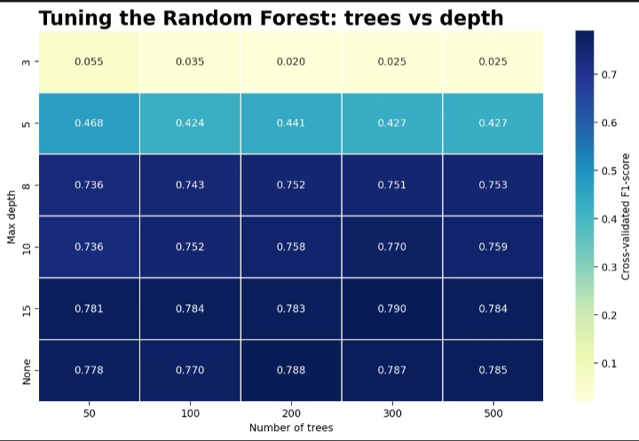
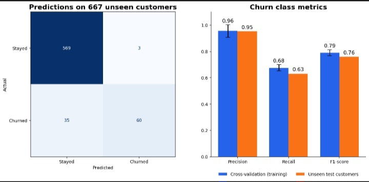
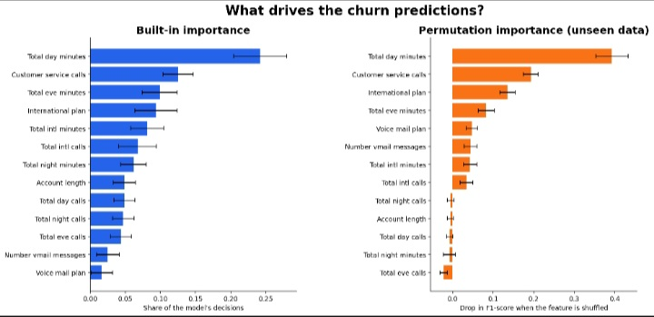

# Random Forest Classifier: Predicting Customer Churn

Codveda Technology Machine Learning Internship · Level 3, Task 1

A reproducible pipeline that trains a Random Forest to predict which telecom
customers will churn, tunes its hyperparameters, evaluates it with
cross-validation and classification metrics, and analyses which features drive
its predictions.

## Dataset

Two files from the same telecom churn dataset:

- `churn-bigml-80.csv`: 2,666 customers, used for training and tuning
- `churn-bigml-20.csv`: 667 customers, used only for the final evaluation

Only about 14.6% of customers churn, so the classes are imbalanced. A model that
always predicts "no churn" would be 85.8% accurate but useless, so the project
focuses on precision, recall and F1 for the churn class instead of accuracy.

## Pipeline

| Step | Script | What it does |
|------|--------|--------------|
| 1 | `01_train_and_tune.py` | Preprocesses data, tunes trees and depth with grid search |
| 2 | `02_evaluate_model.py` | Cross-validation plus precision, recall, F1 on unseen customers |
| 3 | `03_feature_importance.py` | Built-in and permutation feature importance |

## Key decisions

- **Features (13).** Dropped the 4 charge columns (exact copies of the minutes
  columns), `Area code`, and `State`. In a quick test, adding `State` as extra
  columns lowered cross-validated F1 from about 0.77 to 0.68.
- **Tuned on F1, not accuracy,** because of the class imbalance.
- **Grid search with 5-fold stratified cross-validation:** 5 tree counts
  (50 to 500) x 6 depths (3 to unlimited) = 30 settings, 150 model fits. The
  test set is not touched until step 2.





- **Depth matters a lot.** Shallow trees (depth 3 or 5) barely find any
  churners (F1 0.02 to 0.47). The score jumps at depth 8 and reaches about 0.78
  at depth 15 or unlimited.
- **The number of trees barely matters** beyond about 200.
- **Best setting:** 300 trees, max depth 15 (cross-validated F1 0.790, versus
  0.770 for default settings). The top settings differ by less than the
  fold-to-fold noise (about 0.02), so several settings are about equally good.

## Results

| | Cross-validation (training) | Unseen test customers |
|---|---|---|
| Precision | 0.955 | 0.952 |
| Recall | 0.675 | 0.632 |
| F1-score | 0.790 | 0.759 |
| Accuracy | 0.948 | 0.943 |

Test ROC AUC: 0.926.

- Of 63 customers flagged as churners, 60 really churned (3 false alarms).
- Of 95 real churners, 60 were caught and 35 missed.
- Cross-validation and test scores are close, so the model is not overfit.
- The model is cautious: very precise, but it misses over a third of churners.





## What drives churn predictions

Permutation importance (how much F1 drops when a feature is shuffled on unseen
data) is used as the main ranking, because built-in importance can favour
continuous features.

| Feature | F1 drop when shuffled | Churners vs customers who stayed |
|---|---|---|
| Total day minutes | 0.39 | 17% more minutes |
| Customer service calls | 0.19 | 52% more calls |
| International plan | 0.14 | 3.6x more likely to have one |
| Total evening minutes | 0.08 | 5% more minutes |
| Voice mail plan | 0.05 | 43% less likely to have one |

Five features (night calls, account length, day calls, night minutes, evening
calls) have about zero or slightly negative importance: shuffling them does not
hurt the model, so they add noise.





## Limitations and next steps

- Importance shows what the model relies on, not what causes churn, and
  correlated features can share credit.
- The default decision threshold (0.5) favours precision. Lowering it trades
  some precision for more recall; in a quick check on the test set, a threshold
  of 0.4 gave precision about 0.88 and recall about 0.81. A real threshold
  should be chosen with cross-validation on training data, not on the test set.
- The five low-importance features could be dropped to test whether a simpler
  model does as well.

## Setup and run

```bash
pip install -r requirements.txt
python run_all.py
```

The full pipeline takes about 2 to 3 minutes (step 1 fits 150 models). Generated
files go to `data/processed/` and `artifacts/` (not tracked in Git); tables and
metrics go to `outputs/`.

To run a single step: `python src/02_evaluate_model.py`
(run from the repository root, after step 1).

### Run in Google Colab

```python
!git clone https://github.com/nikwesamkelo-max/codveda-ml-task5-random-forest.git
%cd codveda-ml-task5-random-forest
!pip install -r requirements.txt
!python run_all.py
```

## Tools

Python, pandas, scikit-learn, matplotlib, seaborn, joblib

## Author

Samkelo · [GitHub](https://github.com/nikwesamkelo-max) ·
[LinkedIn](https://linkedin.com/in/samkelo-nikwe-93226b344)
